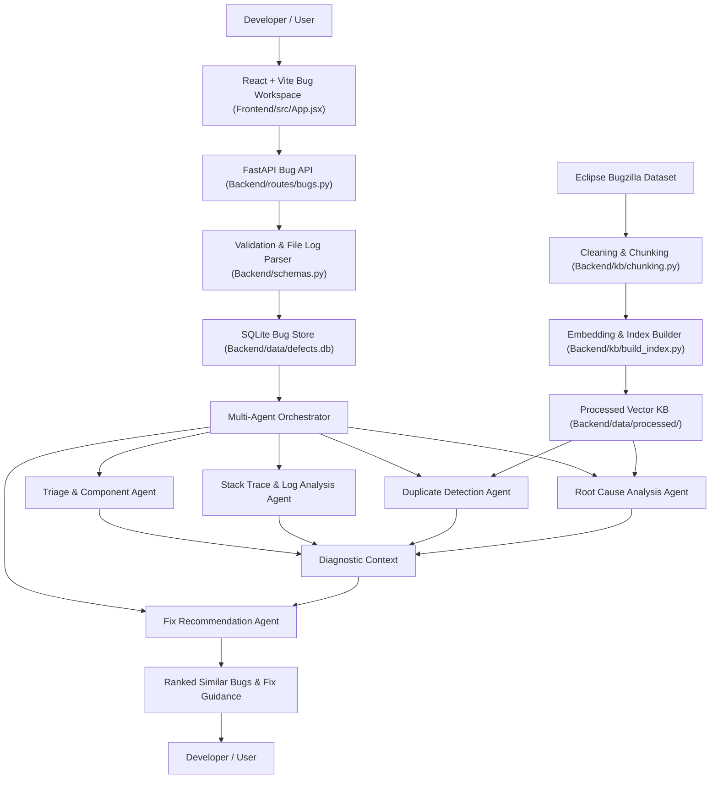
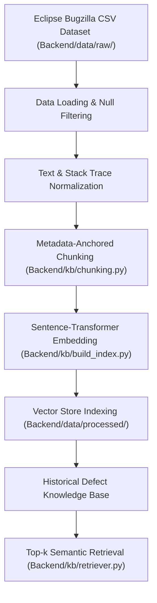

# Intelligent Bug Diagnosis & Historical Defect Triage Platform

**Infosys Springboard Virtual Internship Program**

An AI-powered software debugging and defect intelligence platform designed to automate bug triage, historical defect retrieval, root-cause identification, and fix recommendation using Retrieval-Augmented Generation (RAG), semantic similarity, and multi-agent orchestration.

---

## 📌 Project Overview

Manual bug triage and software debugging require engineers to manually sift through unstructured bug descriptions, multi-line Java stack traces, application logs, and thousands of historical issue records to determine whether a defect is a duplicate or a regression.

The **Intelligent Bug Diagnosis & Historical Defect Triage Platform** streamlines this process by allowing developers to submit structured bug reports alongside diagnostic log files, automatically indexing the failure context, and retrieving semantically similar historical defects from Eclipse Bugzilla repositories to surface root causes and actionable fix recommendations.

### 🎯 Objectives

* Automate initial defect classification and routing across software components (e.g., `JDT / Core`, `Platform / UI`).
* Support dual-mode bug ingestion via direct structured text submission and raw log/stack-trace file uploads.
* Construct a historical defect knowledge base seeded with public Eclipse Bugzilla records.
* Apply dense sentence embeddings and cosine similarity search to identify duplicate and related bugs.
* Parse stack traces, error logs, and runtime environment metadata (`OS`, `JDK/Runtime`) to isolate failure signatures.
* Orchestrate specialized diagnostic agents to identify potential root causes and recommend fixes.
* Reduce manual debugging effort and improve developer productivity.

---

## 🏗️ System Architecture

The platform follows a decoupled, modular multi-agent architecture separating the React/Vite client workspace from a FastAPI orchestration layer and a vector-backed historical knowledge base.

### High-Level Architecture



### Architecture Components (Codebase Mapping)

| Component | Module Path | Responsibility |
| :--- | :--- | :--- |
| Frontend Workspace | `Frontend/src/App.jsx` | Captures bug metadata (`title`, `component`, `environment`), stack traces, file uploads, and search queries |
| FastAPI Application | `Backend/main.py` | Initializes the FastAPI server, CORS middleware, and mounts bug API routers |
| Bug API Routes | `Backend/routes/bugs.py` | Handles bug creation (`POST /api/bugs`), file uploads into `Backend/data/uploads/`, and retrieval queries |
| Data Validation | `Backend/schemas.py` | Defines Pydantic request/response models for bug payloads and similarity matches |
| Relational Persistence | `Backend/database.py` | Manages SQLite connections and CRUD operations against `Backend/data/defects.db` |
| Text Chunking Engine | `Backend/kb/chunking.py` | Splits Eclipse Bugzilla descriptions and stack traces into metadata-anchored chunks |
| Index Builder | `Backend/kb/build_index.py` | Processes raw datasets (`Backend/data/raw/`), generates embeddings, and writes artifacts to `Backend/data/processed/` |
| Semantic Retriever | `Backend/kb/retriever.py` | Executes Top-$k$ vector similarity search against the processed knowledge base |

### Five Specialized AI Agents

**1. Triage & Component Agent**
* Examines incoming bug titles, descriptions, and environment strings.
* Validates or predicts target subsystem routing (e.g., `JDT / Core`) and assigns priority/severity classifications.

**2. Stack Trace & Log Analysis Agent**
* Parses raw Java stack traces and uploaded error logs stored in `Backend/data/uploads/`.
* Isolates primary exception classes, failing call frames, and runtime constraints (e.g., `Windows 11 | JDK 17`).

**3. Duplicate Detection Agent**
* Queries the Eclipse Bugzilla vector knowledge base (`Backend/kb/retriever.py`) using dense semantic similarity.
* Identifies existing duplicate or closely related historical bug IDs to prevent redundant investigation.

**4. Root Cause Analysis Agent**
* Cross-references the incoming failure signature with historical bug discussions, stack traces, and resolutions.
* Synthesizes likely underlying causes in code logic, dependencies, or environment configuration.

**5. Remediation & Fix Recommendation Agent**
* Leverages historical patches, resolution notes, and root-cause findings.
* Generates targeted corrective actions, code fixes, or diagnostic workarounds for the developer.

---

## 🛠️ Technology Stack

| Concern | Selection | Why it fits |
| :--- | :--- | :--- |
| Frontend | React.js + Vite | Component-based UI (`Frontend/src/App.jsx`) for bug submission, file uploads, and fast local HMR workflow |
| Backend | Python + FastAPI | High-performance async Python AI ecosystem, typed REST endpoints (`/api/bugs`), and OpenAPI integration |
| Relational Database | SQLite (`Backend/data/defects.db`) | Lightweight, zero-config structured persistence for bug metadata, components, and environments |
| Vector Database / Index | FAISS / Local Vector Store | Fast dense vector similarity search stored in `Backend/data/processed/` across Eclipse Bugzilla records |
| Embeddings | Sentence Transformers (`all-MiniLM-L6-v2`) | Lightweight 384-dimensional baseline for semantic defect and stack trace retrieval |
| Deep Learning Backend | PyTorch | Execution runtime powering transformer-based embedding inference |
| LLM | Google Gemini API | Natural-language defect reasoning, root-cause synthesis, and fix recommendation |
| Orchestration | Modular Python Pipeline / LangGraph | Stateful multi-agent workflow control across triage, log analysis, and retrieval stages |
| Data Handling | Pandas, NumPy | Cleaning, normalizing, and vectorizing the Eclipse Bugzilla dataset |
| File & Log Parsing | Python Standard Library (`io`, `re`, `csv`) | Extracting raw text and exception frames from uploaded `.log`, `.txt`, and stack trace files |
| ORM & Validation | Pydantic, SQLite3 / SQLAlchemy | Strict request payload validation (`Backend/schemas.py`) and DB mapping (`Backend/database.py`) |
| Testing | Pytest | Unit and integration testing for submission endpoints and retrieval accuracy |
| API Testing | Postman / Thunder Client | Manual endpoint validation for multipart file uploads and JSON payloads |
| API Documentation | OpenAPI / Swagger UI | Interactive API contract inspection at `http://127.0.0.1:8000/docs` |
| Version Control | Git & GitHub | Source control, milestone tracking, and collaborative review |

### Core AI/ML Concepts

* Natural Language Processing (NLP)
* Retrieval-Augmented Generation (RAG)
* Metadata-Anchored Text Chunking
* Dense Sentence Embeddings
* Vector Indexing & Approximate Nearest Neighbor (ANN) Search
* Cosine Similarity Scoring
* Multi-Agent Systems

---

## 📂 Project Development – Milestone 1

**Milestone 1: Foundation, Bug Submission & Historical Defect Knowledge Base**

Milestone 1 establishes the theoretical foundation, end-to-end system architecture, interactive bug submission module, and vector-indexed historical knowledge base using Eclipse Bugzilla records.

### M1.1 – Defect Analysis, RAG & Semantic Similarity Study

* **Defect Analysis Workflows:** Analyzed end-to-end software triage lifecycles—ingestion, deduplication, component routing, and root-cause resolution—identifying bottlenecks in manual Bugzilla triage.
* **Bug Report Anatomy:** Studied public Bugzilla schemas (focusing on the **Dataset on Eclipse Bug Records on Bugzilla** from Kaggle), mapping structured fields (`bug_id`, `product`, `component`, `op_sys`, `severity`) and unstructured fields (`short_desc`, `long_desc`, stack traces).
* **RAG Architecture:** Designed a dual-stage Retrieval-Augmented Generation pipeline pairing offline document chunking and vector indexing with online query embedding and Top-$k$ context retrieval to prevent LLM hallucinations.
* **Semantic Similarity Techniques:** Evaluated dense bi-encoder embeddings (`all-MiniLM-L6-v2`) and L2-normalized cosine similarity ($\text{Similarity}(\mathbf{q}, \mathbf{d}) = \frac{\mathbf{q} \cdot \mathbf{d}}{\|\mathbf{q}\| \|\mathbf{d}\|}$) over purely lexical keyword matching (TF-IDF/BM25) to capture semantic equivalence across varied developer descriptions and Java exception frames.

### M1.2 – System Architecture, Agent Responsibilities & Data Model

* **Decoupled Client-Server Architecture:** Established clear separation between `Frontend/` (React + Vite), `Backend/` (FastAPI), and local SQLite/vector storage (`Backend/data/`).
* **Multi-Agent Orchestration:** Defined specialized responsibilities and execution flow across the five diagnostic agents (Triage, Log Analysis, Duplicate Detection, Root Cause, and Remediation).
* **Knowledge Base & Submission Data Models:**

  **Bug Submission Payload Schema (`Backend/schemas.py`):**

  ```json
  {
    "bug_id": "string (UUID or Bugzilla ID)",
    "title": "string",
    "component": "string (e.g., JDT / Core)",
    "environment": "string (e.g., Windows 11 | JDK 17)",
    "description": "string",
    "stack_trace": "string (optional)",
    "attachments": ["string (extracted log text)"],
    "created_at": "ISO-8601 timestamp"
  }
  ```

  **Vector Chunk & Metadata Record Schema (`Backend/kb/`):**

  ```json
  {
    "chunk_id": "string (bug_id_chunk_index)",
    "parent_bug_id": "string",
    "component": "string",
    "resolution": "string",
    "text_content": "string",
    "embedding_vector": "float32[384]"
  }
  ```

### M1.3 – Bug Submission Module

Developed an interactive React interface (`Frontend/src/App.jsx`) and FastAPI backend (`Backend/main.py`, `Backend/routes/bugs.py`) supporting both direct text paste and multi-file diagnostic uploads.

**Key Features:**
* **Structured Metadata Capture:** Controlled inputs for `title`, `component` (defaulting to `JDT / Core`), and `environment` (e.g., `Windows 11 | JDK 17`).
* **Unstructured Diagnostic Capture:** Dedicated multi-line fields for `description` and raw `stackTrace` payloads.
* **Multi-File Upload Support:** Accepts `.log`, `.txt`, and trace dump attachments (`files` state), saving raw uploads to `Backend/data/uploads/` and extracting text content during backend ingestion.
* **Interactive UI Feedback:** Features tab navigation (`submit` vs. search/browse), loading states, and real-time status banners.

**Implemented API Endpoints (`Backend/routes/bugs.py`):**

| Method | Endpoint | Description |
| :--- | :--- | :--- |
| `GET` | `/` | Root service verification |
| `GET` | `/api/health` | Backend server health check |
| `POST` | `/api/bugs` | Submit a new bug report (with optional stack trace and file attachments) |
| `GET` | `/api/bugs` | Retrieve stored bug records or execute semantic similarity search |

**Example Bug Submission:**

```json
{
  "title": "NullPointerException in JDT Core ASTParser during incremental build",
  "component": "JDT / Core",
  "environment": "Windows 11 | JDK 17",
  "description": "Incremental compilation throws an unhandled NPE when resolving type bindings for annotated inner classes.",
  "stack_trace": "java.lang.NullPointerException\n\tat org.eclipse.jdt.core.dom.ASTParser.createAST(ASTParser.java:1042)"
}
```

### M1.4 – Historical Defect Knowledge Base

Built the offline ingestion, chunking, embedding, and vector indexing pipeline (`Backend/kb/`) seeded with the **Dataset on Eclipse Bug Records on Bugzilla**.

**Knowledge Base Processing Pipeline:**



**Implemented Pipeline Steps:**
1. **Dataset Loading & Cleaning:** Loaded historical Eclipse Bugzilla records via Pandas, pruning incomplete rows and normalizing HTML entities and whitespace while preserving Java stack frames.
2. **Metadata-Anchored Chunking (`Backend/kb/chunking.py`):** Prefixed chunks with parent `bug_id`, `component`, and `title`, splitting lengthy descriptions and stack traces with overlapping windows so exception boundaries remain intact.
3. **Dense Embedding Generation (`Backend/kb/build_index.py`):** Encoded text chunks into 384-dimensional L2-normalized vectors using `sentence-transformers/all-MiniLM-L6-v2`.
4. **Vector Store Indexing & Retrieval (`Backend/kb/retriever.py`):** Indexed dense vectors alongside parent bug metadata in `Backend/data/processed/` to support fast Top-$k$ cosine similarity queries and parent-level deduplication.

**Knowledge Base Processing Summary:**

| Metric | Value |
| :--- | :--- |
| Primary Dataset | Eclipse Bug Records on Bugzilla (`Dataset on Eclipse Bug Records on Bugzilla.csv`) |
| Processed Bug Records | `5,000` |
| Indexing & Retrieval Modules | `Backend/kb/build_index.py`, `Backend/kb/chunking.py`, `Backend/kb/retriever.py` |
| Processed Index Directory | `Backend/data/processed/` |
| Embedding Model & Dimension | `all-MiniLM-L6-v2` (`384` dims) |

---

## 🔄 Overall System Workflow

1. **Bug Submission:** Developer enters `title`, `component`, `environment`, `description`, `stackTrace`, or attaches log files in `Frontend/src/App.jsx`.
2. **API Dispatch:** Frontend sends the payload to `http://127.0.0.1:8000/api/bugs`.
3. **Validation & Parsing:** FastAPI (`Backend/routes/bugs.py`) validates the request via `Backend/schemas.py` and extracts text from uploaded log files in `Backend/data/uploads/`.
4. **Storage:** The structured bug report is saved to SQLite (`Backend/data/defects.db`) via `Backend/database.py`.
5. **Embedding Generation:** The system converts the combined defect narrative and stack trace into a 384-dimensional semantic vector.
6. **Historical Retrieval:** `Backend/kb/retriever.py` queries the processed Eclipse Bugzilla vector store (`Backend/data/processed/`) for the Top-$k$ semantically similar defects.
7. **Multi-Agent Diagnosis:** Specialized agents analyze the retrieved matches, environment metadata, and failure trace.
8. **Root Cause & Fix Recommendation:** Diagnostic findings and actionable remediation steps are returned to the developer UI.

---

## 📁 Project Structure

```text
Infosys-Springboard-Internship/
├── Backend/
│   ├── data/
│   │   ├── processed/                            # Generated embeddings & vector index artifacts
│   │   ├── raw/                                  # Raw historical defect datasets
│   │   ├── uploads/                              # User-uploaded stack traces & error logs
│   │   └── defects.db                            # SQLite database for submitted bug records
│   ├── kb/
│   │   ├── build_index.py                        # Offline ingestion, embedding & index builder
│   │   ├── chunking.py                           # Overlapping text & stack-trace chunker
│   │   └── retriever.py                          # Cosine similarity search & ranking engine
│   ├── routes/
│   │   └── bugs.py                               # REST endpoints (/api/bugs) & file upload handler
│   ├── database.py                               # SQLite session & table definitions
│   ├── main.py                                   # FastAPI entry point
│   ├── schemas.py                                # Pydantic schemas
│   └── requirements.txt                          # Python dependencies
├── Docs/                                         # Supporting architecture & milestone documentation
├── Frontend/
│   ├── public/                                   # Static assets
│   ├── src/
│   │   ├── assets/                               # UI icons & media
│   │   ├── App.css                               # Component styles
│   │   ├── App.jsx                               # Main bug submission & search UI
│   │   ├── index.css                             # Global stylesheet
│   │   └── main.jsx                              # React DOM entry point
│   ├── index.html                                # HTML template
│   ├── package.json                              # Frontend dependencies & scripts
│   └── vite.config.js                            # Vite bundler configuration
├── Dataset on Eclipse Bug Records on Bugzilla.csv # Source Kaggle dataset
├── .gitignore                                    # Git ignore rules
├── LICENSE                                       # Repository license
└── README.md                                     # Complete project documentation
```

---

## 🚀 Quick Start & Milestone 1 Testing

### 1. Build the Historical Knowledge Base (If Not Already Indexed)

```bash
cd Backend
python -m kb.build_index
```

### 2. Backend Setup

```bash
cd Backend
python -m venv venv
# Windows PowerShell: .\venv\Scripts\Activate.ps1
# macOS/Linux: source venv/bin/activate
pip install -r requirements.txt
uvicorn main:app --reload --host 127.0.0.1 --port 8000
```

### 3. Frontend Setup

```bash
cd Frontend
npm install
npm run dev
```

### 4. Milestone 1 Verification Scope

* **Server & Docs:** Confirm FastAPI startup and inspect OpenAPI endpoints at `http://127.0.0.1:8000/docs`.
* **Direct Bug Submission:** Submit a test defect via `Frontend/src/App.jsx` (`Submit` tab) with `component` set to `JDT / Core` and verify storage in `Backend/data/defects.db`.
* **File Upload Parsing:** Attach a `.txt` or `.log` stack trace file, verify storage in `Backend/data/uploads/`, and confirm clean text extraction.
* **Knowledge Base Retrieval:** Query the indexed Eclipse Bugzilla knowledge base (`5,000` records) via `Backend/kb/retriever.py` and verify ranked semantic similarity results.